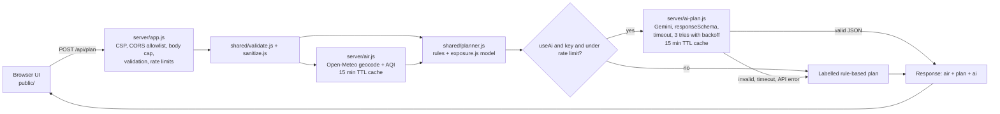

# ClearAir: urban air quality assistant

PromptWars Challenge 6, Urban Air Quality Assistant. Built for severe winter smog.

ClearAir reads the live air quality for a city (or GPS position), takes a short description of the user's day, and returns a plan for **routine**, **home air** and **lower-emission swaps**. Every step says why, and a mass-balance exposure model shows how many micrograms of PM2.5 each choice avoids. An optional Gemini layer rewrites the plan in plain language. If Gemini is off or fails, a rule-based plan is shown and labelled as such.

## Architecture



## Rubric mapping

| Parameter | Where it is addressed |
| --- | --- |
| Problem statement alignment | Routine, indoor-air and low-emission steps; tailored by city or GPS, commute, cooking fuel, windows, purifier CADR, children, older adults, asthma, pregnancy; each step has a Why and a measured effect (`shared/planner.js`) |
| Code quality | Small single-purpose ES modules (`server/`, `shared/`, `public/js/`), no runtime dependencies, pure planning and model code separated from I/O, JSDoc and cited formulas, ESLint with strict rules |
| Security | Strict CSP, CORS allowlist, per-route input validation and body cap, rate limits (plan 20/min, Gemini 8/min per client), prompt-injection defense, key only in env and header, `.env.example`, `.gitignore`, ESLint security plugin and Semgrep clean, `npm audit` 0 |
| Efficiency | 15 min TTL caches with in-flight de-duplication for AQI fetches and identical Gemini requests, preloaded static files, no runtime dependencies, repo well under 1 MB |
| Testing | 116 tests (unit and HTTP integration) using the Node test runner, coverage gate in CI |
| Accessibility | Semantic landmarks, labelled fields, visible focus, contrast checked, live region for results, reduced-motion support, works without a mouse |

## Gemini pipeline (`server/ai-plan.js`)

- Request: REST `generateContent` with `responseMimeType: application/json` and a `responseSchema`. The key is sent in the `x-goog-api-key` header, never in a URL or log. Model defaults to `gemini-3.8-flash` (the model Google's API named when it retired `gemini-2.5-flash` for new users); set `GEMINI_MODEL` to change it. If the chosen model answers HTTP 404, 429 or 5xx (after its own retry with backoff) or a timeout, the pipeline tries `gemini-flash-latest` then `gemini-2.5-flash-lite` before falling back to the rule-based plan. Auth and bad-request errors (400, 401, 403) do not switch models (a timeout does: a hung model is skipped without a second wait). If replies are slow or time out on a thinking model, set `GEMINI_THINKING_BUDGET` (for example `0` or `1024`) to cap hidden reasoning tokens; it is only sent when set.
- Output is parsed and **strictly validated** (types, lengths, step count). Recoverable malformed output (code fences, trailing text) is repaired once; anything else is rejected.
- Reliability: per-attempt timeout (15 s), a 55 s budget across all models, one retry per model on 429/5xx/network errors with exponential backoff and jitter; a timeout moves straight to the next model.
- Fallback: only if the key is missing, the user did not opt in, the rate limit is hit, or the call fails (`timeout`, `api_error`, `invalid_output`, `rate_limited`, `no_api_key`). The response carries `ai.source` (`gemini`, `fallback`, `off`) and a human label, and the UI shows a banner saying which plan you are reading.
- Prompt-injection defense: the model only receives validated facts (AQI, ticked groups, catalogue step titles). City is reduced to a letters-only label. Free-text notes (200 chars max) are normalised, scanned with a word-window detector (no backtracking regex), dropped completely if they look like instructions, and otherwise placed between delimiters in a data-only section the system prompt tells the model to treat as untrusted. Model text is cleaned of markup before display and rendered with `textContent`.

## Exposure model (`shared/exposure.js`)

Daily inhaled dose, in micrograms of PM2.5:

```
dose = sum over microenvironments of  C_i * V_i * t_i        (ug/day)
```

`C_i` is concentration (ug/m3), `V_i` inhalation rate (m3/h), `t_i` hours. Indoor concentration uses the steady-state single-zone mass balance:

```
C_in = ( P * a * C_out + S / V ) / ( a + k + CADR / V )
```

`P` penetration 0.8, `a` air changes per hour (2.0 windows open, 0.5 closed), `k` deposition 0.2 /h, `CADR` purifier clean air delivery rate (default 200 m3/h, user adjustable 20 to 1000), `V` room volume 40 m3 (kitchen 15 m3), `S` source emission rate (ug/h). Kitchen emissions by fuel: biomass 46800, LPG 3000, induction/electric 600 ug/h; an exhaust fan raises kitchen air changes from 5 to 15 /h. Commute uses in-vehicle to ambient ratios (walk 1.0, cycle 1.0, two-wheeler 1.1, bus 0.9, metro 0.7, car 0.6) with mode-specific breathing rates. Masks apply a protection factor of 5, deliberately half the OSHA assigned factor of 10 for a well-fitted filtering facepiece, to allow for real-world leakage. Compared with the WHO 24-hour guideline of 15 ug/m3.

Sources: US EPA Exposure Factors Handbook (2011) ch. 6 (inhalation rates); Klepeis et al. 2001, J Expo Anal Environ Epidemiol 11:231 (time spent indoors); Riley et al. 2002, Environ Sci Technol 36:200 (indoor particle dynamics); Wallace 1996, Indoor Air 6:50; Chen and Zhao 2011, Atmos Environ 45:275 (penetration and deposition); Kaur, Nieuwenhuijsen and Colvile 2007, Atmos Environ 41:4781 (commuter exposure); Smith et al. 2014, Annu Rev Public Health 35:185 (household fuel); OSHA 29 CFR 1910.134; WHO Global Air Quality Guidelines 2021. The same formulas appear in the in-app "How the numbers are calculated" panel and tooltips.

**Honest limit:** the constants are assumptions chosen from the ranges in these sources. The model compares choices; it does not measure any person's exposure and is not medical advice.

AQI uses the US EPA PM2.5 breakpoint table (2024 revision), clamped to 0 to 500; values above 500 are reported as 500+.

## API

| Route | Notes |
| --- | --- |
| `GET /healthz` | `{ok:true}` |
| `GET /api/config` | `{aiEnabled}` |
| `POST /api/plan` | Body `{city \| lat+lon \| aqi, profile, notes?, useAi?}` returns `{air, plan, ai}`. Validated, 16 KB cap, 20/min per client, Gemini 8/min per client. Errors are `{error:{code,message}}` with 400, 404, 413, 415, 429 or 502 |

## Run locally

```bash
npm install          # dev tools only; the app has no runtime dependencies
cp .env.example .env # optional, then export the values you want
GEMINI_API_KEY=... npm start   # http://localhost:8080 ; omit the key to see the labelled fallback
npm run check        # lint + tests with coverage gate
```

If the page shows the rule-based fallback while AI is ticked, the banner and the server log print the reason and Google's error. Run `npm run diagnose` (with `GEMINI_API_KEY` set) to see the raw failure, or `npm run diagnose:ladder` to send five requests of rising complexity (plain, thinking off, JSON mode, schema, schema with thinking off) and see which one is slow; set `GEMINI_MODEL` if the model name is rejected.

Get a free Gemini key at https://aistudio.google.com/apikey. Node 20 or newer.

### Docker

```bash
docker build -t clearair .
docker run -p 8080:8080 -e GEMINI_API_KEY=... -e TRUST_PROXY=1 clearair
```

The image includes a `/healthz` health check and runs as the non-root `node` user.

### Live demo notes

Deploy the Dockerfile on Render or Cloud Run, set `GEMINI_API_KEY` and `TRUST_PROXY=1` as environment variables. Free tiers sleep when idle: open `/healthz` a minute before a demo. Try city "Delhi", tick children and asthma, enable AI, then compare "your day as is" with "with this plan".

## Quality checks

```bash
npm run lint            # ESLint, strict rules + eslint-plugin-security: 0 errors, 0 warnings
semgrep --config p/javascript --metrics off .   # 0 findings (68 rules)
npm audit               # 0 vulnerabilities
npm run test:coverage   # 116 tests; 100% lines, 97% branches, 99% functions
```

CI (`.github/workflows/ci.yml`) runs lint, `npm audit`, Semgrep, tests with coverage thresholds, and a Docker build.

## Known limits

- The Gemini path is tested against a fake `fetch` that returns the documented response shape (valid, malformed, timeout, error, injection cases). It has not been run against the live API from the build environment; check the model name with a real key.
- Air data comes from Open-Meteo (modelled CAMS data, not a ground monitor). If it is down the API returns 502 with a clear message.
- Rate limits and caches are in memory, per process.
